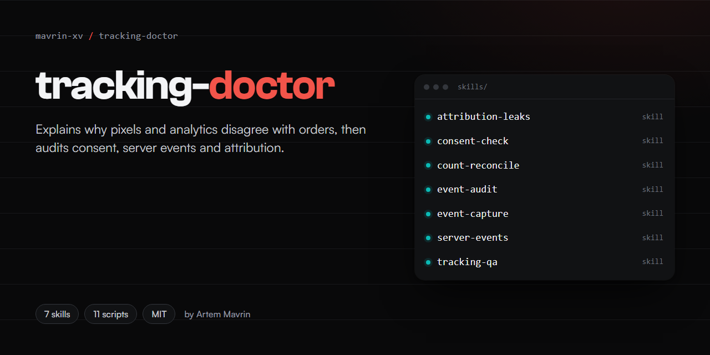

# tracking-doctor

**Find out why your pixels and analytics disagree with your orders, and fix it: capture what really fires, audit it against a plan, then check consent, server events, attribution leaks and counts.**

GA4 says 52 purchases, the shop says 40, Meta says 61, a third of the traffic is Unassigned, and nobody can say which number to trust or since when.

[](LICENSE)


```bash
git clone https://github.com/mavrin-xv/tracking-doctor && cd tracking-doctor
./install.sh  # or: ./install.sh --project
```

<!-- install-notes:start -->
Other ways in: as a Claude Code plugin, run `/plugin marketplace add mavrin-xv/tracking-doctor` and then `/plugin install tracking-doctor@tracking-doctor`. For Codex or another agent that reads `SKILL.md`, copy the folders under `skills/` into its skills directory. On Windows, run `install.sh` from Git Bash or WSL and type `py -3` where these docs say `python3`.
<!-- install-notes:end -->

Then say "capture the tracking on https://your-site.example and audit it".

---

## What it solves

| Pain | Fix in this repo |
|---|---|
| Purchases are counted twice, revenue looks better than the bank account | `capture.py` reloads the thank-you page; `audit.py` flags every order id sent twice and every second tag |
| Nobody knows what the tags really send | a headless browser walks the journey and records every GA4, Google Ads, Meta, PostHog, TikTok, LinkedIn and UET request |
| The pixel fires before the cookie banner, or nothing fires after Accept | `consent.py` splits the capture at the banner click and checks hits, `gcs` signals and cookies on both sides |
| Server events get a 200 and never show up | `mp_check.py` lints GA4 Measurement Protocol and PostHog payloads and calls the GA4 debug endpoint |
| A third of sessions are Unassigned, PayPal is a top referrer | `leaks.py` follows click ids through redirects and lints the source / medium export |
| Three tools, three numbers | `reconcile.py` compares each tool with the backend by day and by order id, and says which gap is a bug |
| A release breaks tracking and nobody notices for a month | `checklist.py` turns the plan into a release test; the scripts exit 1 so CI goes red |

## What's inside

| Skill | What it does | Say |
|---|---|---|
| `event-capture` | Headless browser journey (or a HAR file) to a record of every tracking request | "capture what my pixels send", "is purchase firing" |
| `event-audit` | Capture against tracking plan: missing, doubled, params, order ids, currency, PII | "audit my events", "GA4 shows more purchases than orders" |
| `consent-check` | What fires before and after Accept and Reject, Consent Mode basic or advanced | "does my cookie banner work", "consent mode v2 check" |
| `server-events` | Lint and validate GA4 Measurement Protocol and PostHog payloads | "server events don't show up", "send purchases from the backend" |
| `attribution-leaks` | Lost click ids and UTMs, payment and self referrals, Unassigned share | "why is so much traffic Unassigned", "check my UTMs" |
| `count-reconcile` | Tools against the backend by day and by order id | "GA4 and the shop don't match", "which number is right" |
| `tracking-qa` | Release test checklist from the plan, plus a CI job | "test tracking before release", "add tracking tests to CI" |

## Quick start

```bash
pip install playwright && python3 -m playwright install chromium
S=skills; E=examples/fabrikam-tea
python3 $S/event-capture/scripts/capture.py --steps $E/steps.json --serve $E/site --out capture.jsonl
python3 $S/event-audit/scripts/audit.py capture.jsonl --plan $E/plan.csv
python3 $S/consent-check/scripts/consent.py capture.jsonl --consent-step consent-accept --reject $E/capture-reject.jsonl --reject-step consent-reject
python3 $S/attribution-leaks/scripts/leaks.py --capture capture.jsonl --sources $E/exports/ga4-sources.csv --domain fabrikam-tea.example
python3 $S/count-reconcile/scripts/reconcile.py counts $E/exports/counts.csv
```

The example shop has nine planted problems; `examples/fabrikam-tea/README.md` lists them and
which check finds each. On your own site, write a `steps.json` for your journey and copy
`templates/tracking-plan.csv`. Without Playwright, record a HAR in DevTools and use
`capture.py --from-har`.

## How it works

```text
 steps.json ─► capture.py ─► capture.jsonl ─┬─► event-audit       what fired vs the plan
 (or a HAR)    requests answered locally,   ├─► consent-check     before and after the banner
               nothing reaches vendors      └─► attribution-leaks click ids, UTMs, referrals
 payload.json ──────────────────────────────────► server-events     lint + GA4 debug endpoint
 counts.csv, orders, exports ───────────────────► count-reconcile   tools vs backend
 plan.csv ──────────────────────────────────────► tracking-qa       release checklist, CI gate
```

Order: capture first, because every other judgement needs to know what really fired. Fix
doubles and PII before missing events, then consent, then leaks, and measure the result with
count-reconcile a day later. Details in `docs/how-it-works.md`.

## Configure

| Setting | Where | Default |
|---|---|---|
| Journey | `steps.json`: goto, click, fill, reload, wait | none |
| Send to vendors | `capture.py --live` | off: tracking requests answered locally |
| Proxy hosts | `capture.py --posthog-host`, `EXTRA_POSTHOG_HOSTS` in `trackhits.py` | PostHog cloud hosts |
| Consent mode | `consent.py --mode basic or advanced`, `--expect` vendors | advanced; ga4, meta, posthog |
| GA4 debug | `GA4_MEASUREMENT_ID`, `GA4_API_SECRET` environment variables, `--region eu` | lint only |
| Bands | `reconcile.py --over --under --drift` | 1.05, 0.70, 15 points |
| Unassigned limit | `leaks.py --not-set-max` | 5% |

## Honest limits

- Browser tracking request formats (`/g/collect`, Meta `/tr`, `gcs`, `gcd`) are not documented by the vendors. The patterns match what tags send today and can break; `skills/event-capture/references/vendor-patterns.md` says which are verified.
- A capture sees one journey in one browser. It cannot see blocked visitors, other devices or what the vendor drops after receiving.
- Meta CAPI payloads and browser against server dedup are not covered here; the eid is only checked for presence.
- The channel rules in `leaks.py` are a simplified copy of GA4's default channel group.
- Bands in `reconcile.py` and the 5% Unassigned limit are working rules, not vendor limits.
- consent-check reports what fires. It is not legal advice.
- Tested: every script on the invented example, live captures of the example site, two public sites captured with tracking requests answered locally, a HAR import, and the GA4 debug path against a local mock. Not tested by us: the real GA4 debug endpoint, PostHog ingestion, sites behind a login, server-side GTM, Safari and Firefox engines.
- Tested with Claude Code. Other agents that read SKILL.md files should work; not tested.

## Credits

- https://github.com/petrkindlmann/qa-skills (MIT): the analytics tracking testing method (intercept tracking requests rather than read the DOM, parse query and body, validate against an external plan and report all violations, test consent as an input, fail CI on a dropped event and prove the gate by breaking it). Rewritten, no text copied.
- https://github.com/coreyhaines31/marketingskills (MIT): object_action naming, the checklist of values populated, no duplicates and no PII, auditing UTMs after redirects, and symptom triage. Rewritten, no text copied.
- Google Analytics Measurement Protocol docs (reference, validation, limits), Google tag consent docs, GA4 help "Default channel group" and the Unassigned definition.
- PostHog capture API docs. Meta docs on deduplicating Pixel and Conversions API events.
- Neighbour packs, not duplicated here: `meta-capi` in ads-creative-lab (CAPI build and dedup), `tracking-plan` and `traffic-diagnosis` in marketing-analytics-hub (UTM builder, naming linter), `conversion-cleanup` in google-ads-doctor (conversion action settings).

## Contributing

See `CONTRIBUTING.md`. Coding agents should read `AGENTS.md` first.

<!-- author:start -->
## Author

Built and maintained by [Artem Mavrin](https://github.com/mavrin-xv). This repo is one of a set of agent skill packs for marketing and operations work. Each one installs on its own; the full list is in [agent-skill-packs](https://github.com/mavrin-xv/agent-skill-packs). If a pack saved you an afternoon, a star helps other people find it.
<!-- author:end -->

## License

MIT, see `LICENSE`.
